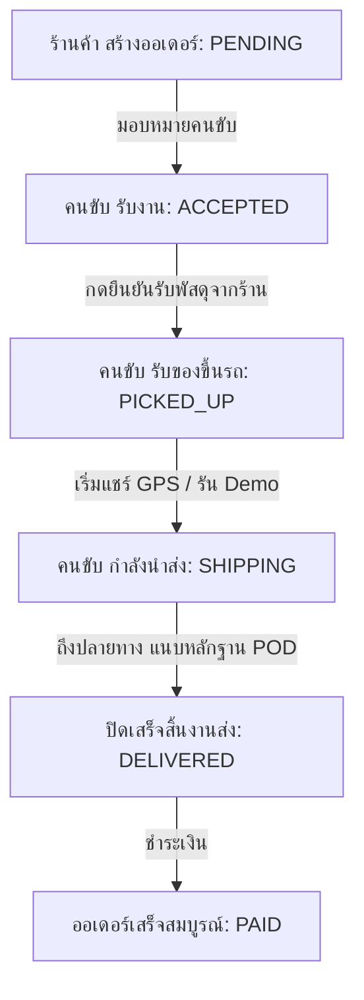

# คู่มือการทดสอบระบบ SwiftPath (Testing Guide)
คู่มือฉบับนี้จัดทำขึ้นเพื่อใช้เป็นแนวทางสำหรับการเตรียมสภาพแวดล้อม การรันระบบ และขั้นตอนการทดสอบระบบขนส่งและจัดการแค็ตตาล็อกสินค้าแบบเรียลไทม์ (SwiftPath) บนเครื่องคอมพิวเตอร์ของคุณ (Local Environment)

---

## 1. สิ่งที่ต้องติดตั้งในเครื่อง (System Requirements)
* **Node.js** (เวอร์ชันแนะนำ: v18 หรือสูงกว่า)
* **Docker Desktop** (สำหรับจำลองฐานข้อมูล PostgreSQL)
* **Git** (สำหรับจัดการเวอร์ชัน)

---

## 2. การเตรียมสภาพแวดล้อม (Environment Setup)

### ขั้นตอนที่ 2.1: ตรวจสอบและรัน Database ด้วย Docker
1. เปิดโปรแกรม **Docker Desktop**
2. ไปที่โฟลเดอร์โครงการหลัก (`d:\Project`) แล้วสั่งเปิด Container:
   ```bash
   docker compose up -d
   ```
3. ตรวจสอบสถานะการทำงานของตู้คอนเทนเนอร์ (ต้องแสดงสถานะ **Up** บนพอร์ต `5432`):
   ```bash
   docker ps
   ```

### ขั้นตอนที่ 2.2: กำหนดค่าไฟล์ตัวแปรระบบ (`.env`)
ตรวจสอบให้แน่ใจว่าในโฟลเดอร์ `backend/.env` มีตัวแปรเชื่อมฐานข้อมูลดังนี้:
```env
# Database Connection URL
DATABASE_URL="postgresql://<DB_USER>:<DB_PASSWORD>@localhost:5432/<DB_NAME>?schema=public"

# ส่วนการตั้งค่าอื่น ๆ (Stripe, Firebase)
JWT_SECRET=<YOUR_JWT_SECRET>
ADMIN_SEED_EMAIL=admin@swiftpath.com
ADMIN_SEED_PASSWORD=<ADMIN_SEED_PASSWORD>
```

---

## 3. การตั้งค่าสิทธิ์เข้าถึง Subdomains (Local Hosts)
เนื่องจาก SwiftPath ทำงานโดยแบ่งพอร์ทัลผู้ใช้ออกตามซับโดเมน คุณจำเป็นต้องเพิ่มโดเมนจำลองลงไปในระบบปฏิบัติการ เพื่อให้เบราว์เซอร์รู้จักชื่อโดเมนเหล่านี้

### สำหรับระบบ Windows
1. ค้นหาโปรแกรม **Notepad** จากช่องค้นหา
2. คลิกขวาแล้วเลือก **"Run as Administrator"** (เปิดในฐานะผู้ดูแลระบบ)
3. กด Open แล้วเลือกไฟล์ไปที่: `C:\Windows\System32\drivers\etc\hosts` (หากไม่เห็นไฟล์ ให้เปลี่ยนฟิลเตอร์มุมล่างขวาจาก `Text Documents (*.txt)` เป็น `All Files (*.*)`)
4. เพิ่มบรรทัดต่อไปนี้ลงไปด้านล่างสุดของไฟล์ แล้วทำการกดบันทึก (Save):
   ```text
   127.0.0.1 app.localhost
   127.0.0.1 store.localhost
   127.0.0.1 fleet.localhost
   ```
   > **หมายเหตุ:** Admin Portal ไม่ใช้ Subdomain — เข้าถึงได้ที่ `http://localhost:3000/admin/login` โดยตรง ไม่ต้องเพิ่ม `admin.localhost` ในไฟล์ hosts

---

## 4. วิธีเริ่มรันเซิร์ฟเวอร์ระบบ (Running Servers)

รันคำสั่งเหล่านี้แยกคนละหน้าต่าง Terminal (หรือ PowerShell):

### หน้าต่างที่ 1: ฝั่งเซิร์ฟเวอร์เบื้องหลัง (NestJS Backend)
```bash
cd backend
npm install
npx prisma generate   # สร้าง Prisma TypeScript Client (ต้องทำก่อนเสมอ)
npx prisma db push    # ซิงค์โครงสร้างตารางเข้า PostgreSQL
npx prisma db seed    # สร้างข้อมูลทดสอบ (Merchant, Driver, Customer, Admin)
npm run start:dev
```
*ระบบจะเปิดทำงานที่: http://localhost:8000*

### หน้าต่างที่ 2: ฝั่งหน้าบ้าน (Next.js Frontend)
```bash
cd frontend
npm install
npm run dev
```
*ระบบจะเปิดทำงานที่: http://localhost:3000*

---

## 5. บัญชีเข้าทดสอบระบบจำลอง (Test Accounts)

| พอร์ทัลระบบ (Portal) | ลิงก์พัฒนา (Local) | ลิงก์คลาวด์จริง (Production) | อีเมลผู้ใช้ | รหัสผ่าน |
| :--- | :--- | :--- | :--- | :--- |
| **Admin Portal** | [localhost:3000/admin/login](http://localhost:3000/admin/login) | [swiftpath-app.xyz/admin/login](https://swiftpath-app.xyz/admin/login) | `admin@swiftpath.com` | `<ADMIN_SEED_PASSWORD>` |
| **Merchant Portal** | [store.localhost:3000](http://store.localhost:3000) | [store.swiftpath-app.xyz](https://store.swiftpath-app.xyz) | `merchant@test.com` | `Test@1234` |
| **Driver Portal** | [fleet.localhost:3000](http://fleet.localhost:3000) | [fleet.swiftpath-app.xyz](https://fleet.swiftpath-app.xyz) | `driver@test.com` | `Test@1234` |
| **Customer Web** | [app.localhost:3000](http://app.localhost:3000) | [app.swiftpath-app.xyz](https://app.swiftpath-app.xyz) | `customer@test.com` | `Test@1234` |
| **Public Tracking** | [localhost:3000](http://localhost:3000) | [swiftpath-app.xyz](https://swiftpath-app.xyz) | *ไม่ต้องล็อกอิน* | ใช้ค้นหาผ่านเบอร์โทรศัพท์ หรือ Tracking ID |

---

## 6. วงจรการทดสอบแบบสิ้นสุด (End-to-End Test Workflow — v2)

เพื่อจำลองการส่งพัสดุจริง ให้ทำตามลำดับขั้นตอนดังนี้:



1. **ขั้นตอนการสร้างงานและแก้ไขข้อมูล (Merchant):**
   * ล็อกอินเข้าสู่หน้าพอร์ทัลร้านค้า (`store.localhost:3000` หรือ `store.swiftpath-app.xyz`)
   * ไปที่เมนู **"สร้างออเดอร์"**
   * เลือกสินค้าจาก Dropdown แคตตาล็อก หรือกรอกสินค้าเอง กรอกรายละเอียดผู้รับ ที่อยู่ และราคาสินค้า จากนั้นกดบันทึก
   * คัดลอกเลข **Tracking Number** (เช่น `SPxxxxxxxxxx`) เอาไว้
   * *(ฟีเจอร์ v2)* ร้านค้าสามารถกดปุ่ม **"แก้ไขข้อมูลลูกค้า"** เพื่อเปลี่ยนชื่อ เบอร์โทร หรือที่อยู่ปลายทางได้ทันทีตราบใดที่สถานะยังเป็น `PENDING` หรือ `ACCEPTED`
   * มอบหมายงานให้คนขับในสังกัด หรือปล่อยให้คนขับกดรับงาน
2. **ขั้นตอนการทำงานของคนขับ (Driver Workflow):**
   * ล็อกอินเข้าสู่หน้าพอร์ทัลคนขับ (`fleet.localhost:3000` หรือ `fleet.swiftpath-app.xyz`)
   * ไปที่หน้ารายละเอียดออเดอร์ที่ได้รับมอบหมาย สถานะจะเริ่มต้นที่ `ACCEPTED`
   * **⚠️ กฎความปลอดภัย v2 (Pickup Guard):** ในสถานะ `ACCEPTED` คนขับจะยังไม่สามารถกดเปิด Live GPS หรือกดเริ่มเดโม่ได้ ระบบจะมีแถบสีส้มแนะนำให้กด **"ยืนยันการรับพัสดุจากร้านค้า"** ก่อนเป็นอันดับแรก
   * เมื่อกดรับพัสดุแล้ว สถานะจะเปลี่ยนเป็น `PICKED_UP` และระบบจะเปิดให้เริ่มแชร์ Real GPS หรือกดปุ่ม **"จำลองเดินทางส่ง (Demo)"** ได้
   * **โหมดจำลอง (Demo Simulation v2):**
     - เมื่อกดเริ่ม Demo ระบบจะเปลี่ยนสถานะเป็น `SHIPPING` (กำลังจัดส่ง) ให้อัตโนมัติ
     - รถจำลองจะวิ่งตามเส้นทางพิกัด Lat/Lng จนถึงบ้านลูกค้า
     - เมื่อวิ่งถึงปลายทาง ระบบจะทำการสร้างรูปถ่ายหลักฐานการจัดส่งจำลอง (Mock POD) และพิกัดส่งมอบให้อัตโนมัติทันที
     - ปลดล็อกปุ่มสีเขียว **"ปิดเสร็จสิ้นงานส่ง (DELIVERED)"** ให้กดส่งงานได้ทันที ไม่เกิดปัญหาปุ่มค้าง
   * เลือกรูปแบบการชำระเงิน (รับเงินสด/โอนแล้ว หรือ สแกน PromptPay QR) เพื่อปิดจบออเดอร์
3. **การติดตามสถานะแบบเรียลไทม์ (Customer):**
   * ไปที่หน้าแรก [localhost:3000](http://localhost:3000) หรือ [swiftpath-app.xyz](https://swiftpath-app.xyz) หรือเข้าผ่านลิงก์ `swiftpath-app.xyz/track/:id`
   * ระบบจะแสดงหมุดแผนที่สดๆ ของคนขับที่กำลังเดินทาง พร้อมเวลาถึงโดยประมาณ (ETA) และสถานะประวัติการจัดส่งครบถ้วน

---

## 7. วิธีแก้ไขปัญหาเบื้องต้น (Troubleshooting)
* **หากรัน backend แล้วขึ้น `Can't reach database server`:**
  * เช็กให้แน่ใจว่า Docker Desktop กำลังเปิดทำงานอยู่และ Container รันแล้ว
  * ทดลองรันคำสั่ง `docker start logistics_db` เพื่อดึงเซิร์ฟเวอร์ขึ้นมาใหม่
* **หากเรียกเว็บในพอร์ทัลย่อยแล้วขึ้น `Site can't be reached`:**
  * ตรวจสอบว่าคุณได้เข้าไปเพิ่มชื่อซับโดเมนจำลองในไฟล์ `hosts` หรือยัง และบันทึกไฟล์นั้นเป็น Admin หรือไม่
* **หากสร้างออเดอร์และขึ้นหน้าสีส้ม/แดงเตือนภัยสภาพอากาศ:**
  * ฟีเจอร์ weather-pricing กำลังจำลองราคาชาร์จเพิ่มเมื่อฝนตก ซึ่งเป็นส่วนหนึ่งของการประเมินราคาตามจริง (Surge Pricing) สามารถกรอกเมืองจัดส่งเป็นภาษาอังกฤษเช่น `Bangkok` หรือ `Nonthaburi` เพื่อให้ระบบเรียกดึงข้อมูลพยากรณ์อากาศมาใช้งานได้จริง
